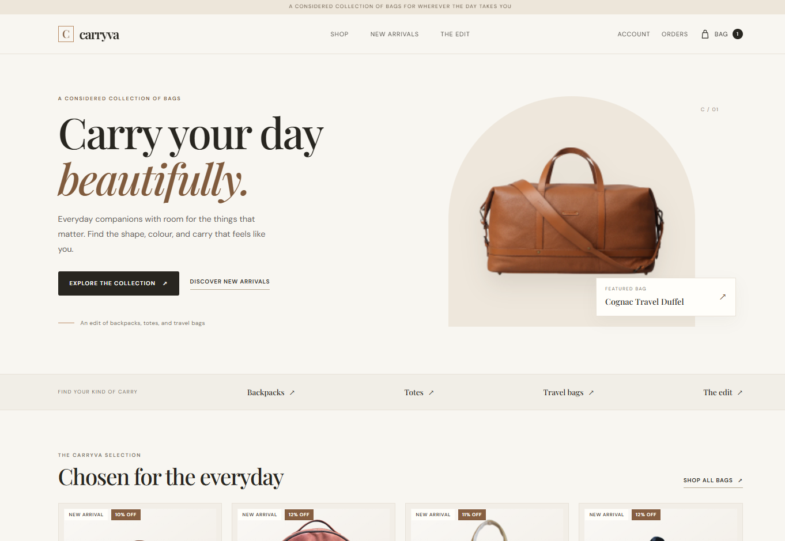
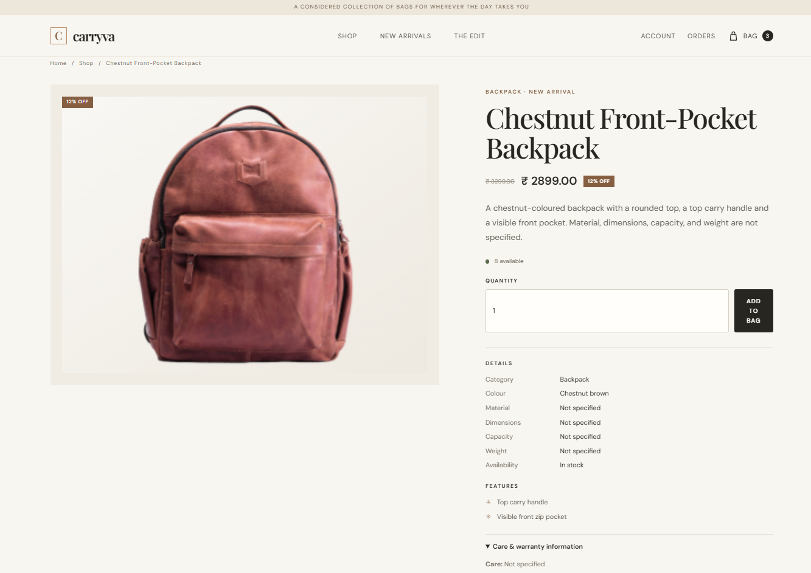
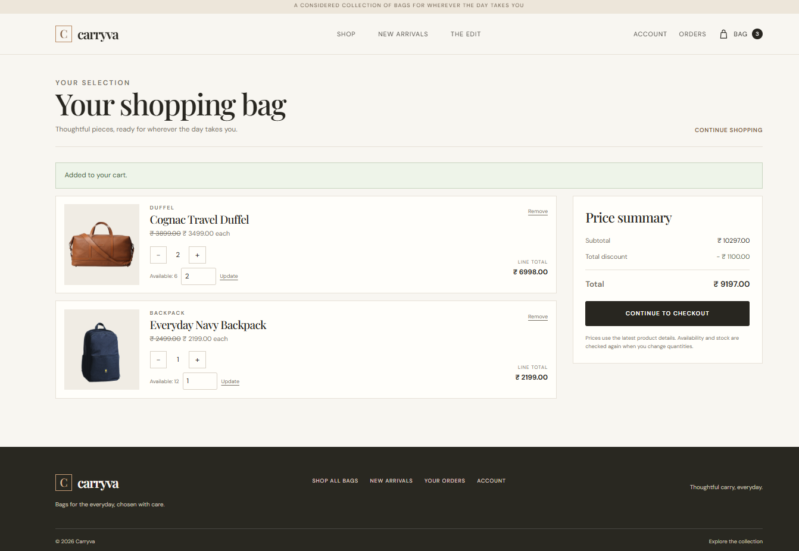
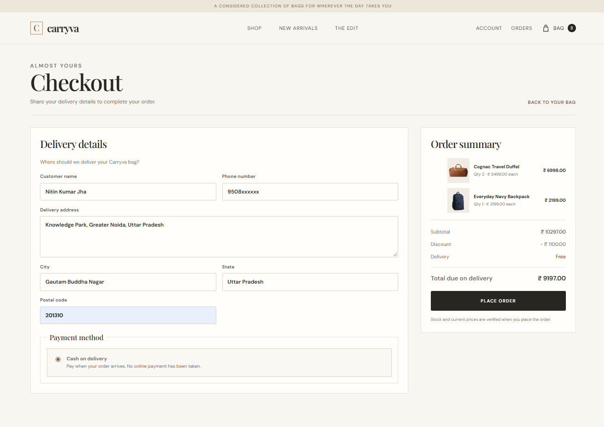

# Carryva

**Carryva** is a premium bags e-commerce web application built with **Node.js, Express, EJS, and MongoDB**. It was developed as a full-stack portfolio project to demonstrate product catalog management, authentication, persistent shopping carts, and order processing.

## Screenshots

### Homepage


### Product Details


### Shopping Cart


### Shop


## Features

- **Product Catalog:** Browse bags, view product details, and explore featured products.
- **Authentication:** Customer login, registration, and session management.
- **Cart Management:** Persistent carts with server-side price and stock validation.
- **Checkout & Orders:** Cash-on-delivery checkout, order history, and order management.
- **Owner Dashboard:** Manage products and update order fulfilment status.
- **Security:** Input validation, rate limiting, secure cookies, and security headers.
- **Deployment Readiness:** Health checks and MongoDB transaction support.

## Tech Stack

- **Backend:** Node.js, Express.js
- **Frontend:** EJS, CSS, JavaScript
- **Database:** MongoDB, Mongoose
- **Authentication:** JWT and Express sessions
- **Testing:** Node.js test runner and integration tests
- **Deployment:** Vercel and MongoDB Atlas

## Local Setup

**Requirements:** Node.js 20+ and MongoDB running as a replica set.

1. Clone the repository:

   ```bash
   git clone https://github.com/NitinDevCodes/carryva.git
   cd carryva
   ```

2. Install dependencies:

   ```bash
   npm ci
   ```

3. Copy `.env.example` to `.env` and configure the required environment variables:

   ```env
   PORT=3000
   NODE_ENV=development
   MONGODB_URI=mongodb://127.0.0.1:27017/?replicaSet=carryva-rs
   MONGODB_DB=Carryva
   JWT_KEY=your_random_secret
   EXPRESS_SESSION_SECRET=your_other_random_secret
   ```

   Generate two distinct random secrets of at least 32 bytes. Configure MongoDB as a replica set before using transactional checkout and cancellation.

4. Start the application:

   ```bash
   npm start
   ```

5. Open [http://localhost:3000](http://localhost:3000).

## Testing

Run the test suite with:

```bash
npm test
```

Transaction tests require a disposable MongoDB replica set. Configure `CARRYVA_TEST_MONGODB_URI` as described in the test documentation.

## Deployment

The application is configured for production deployment with MongoDB Atlas.

Set `NODE_ENV`, `MONGODB_URI`, `MONGODB_DB`, `JWT_KEY`, and `EXPRESS_SESSION_SECRET` in your hosting provider's environment settings. Use HTTPS and configure trusted proxy settings when required.

Health endpoints:

- `/health/live` — application liveness.
- `/health/ready` — database readiness and transaction support.

## Project Status

A portfolio project built to explore full-stack e-commerce development, database transactions, authentication, and deployment practices. Some features may require further refinement.

## License

This project is available for educational and portfolio purposes.
